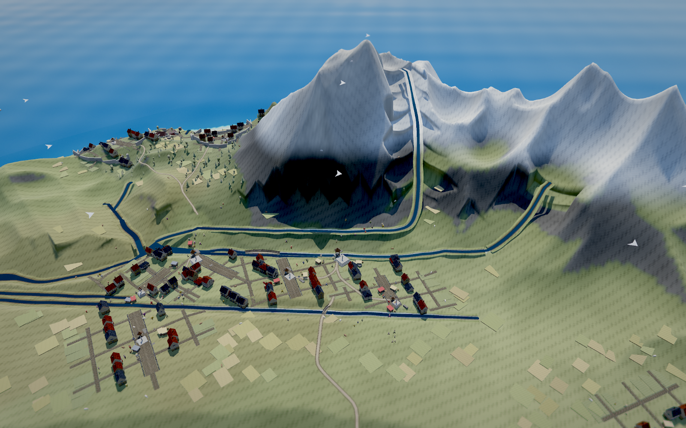
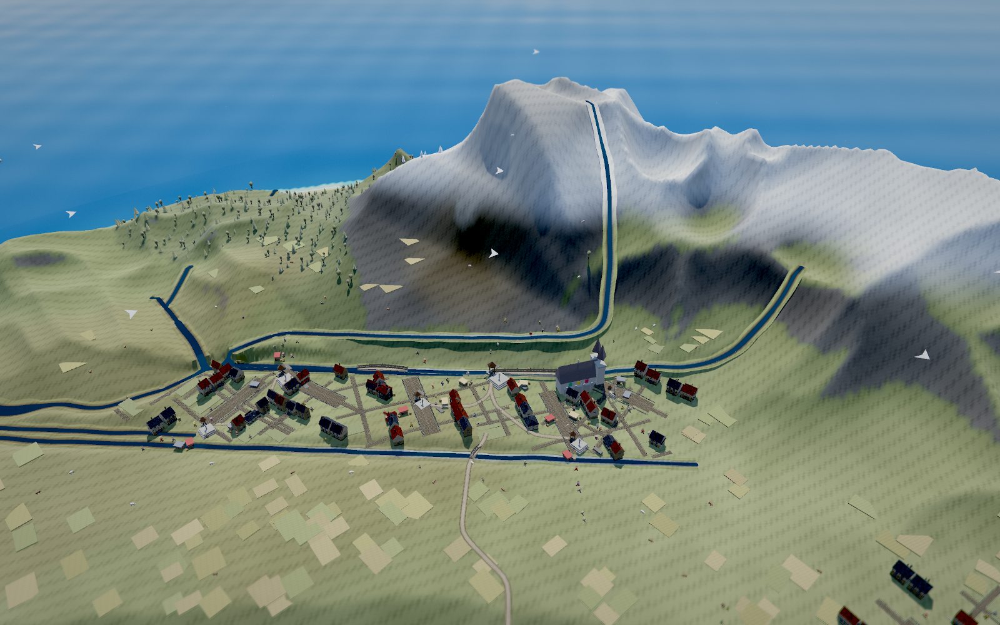

# PR 15 — mountain carve follow-up

Baseline: PR head `44f2b1af5d9c3de277051cec1b7f8eed464a8988`.
The user's saved world is seed `6393821808673518700`. The paired captures use
its screenshot year, 4567, hour 10, weather 0 and this explicit oblique camera:

```sh
EVOLVING_CAMERA='-0.15,0.40,-0.05,0.18,0.06,0.25,52'
```

| Before | After |
|---|---|
|  |  |

The old spatial-hash halo ended a still-active valley carve. A focused fixture
measures terrain jumping **28.694090 → 100.000000 m** across a **0.2 mm** probe
at a bucket boundary. `before-cutoff-regression.txt` records the failure.

The replacement uses a deterministic hierarchy over the drawn water's exposed
surface triangles, so nearest-water queries remain valid outside every bucket.
Outside-water profile interpolation scales with distance to the channel instead
of concentrating a large elevation difference into a fixed 2 m tie strip.
The finite buckets remain only for bounded wetness, bank-exclusion and local
mesh-support queries; they no longer define the extent of a valley.

The conservative interpolation-support constraint now uses local triangle
water gradients and a continuous transition over the existing 4 m wet shelf.
It does not use a distant triangle's lowest endpoint as the local water level.
Terrain normals use the submitted height grid, and existing coarse support
heights are reused rather than repeating global queries for every normal.

Validation now includes every submitted water triangle, all bank triangles,
and dry terrain checked against an exhaustive, unbucketed reconstruction of
the renderer's coarse/fine height pipeline. Determinism additionally hashes the
submitted terrain geometry and normals. The original five junction shapes,
hole fixture, translated cases and subcell-width fixtures remain enabled.

Additional local captures isolate terrain, water, banks and shadows. Matching
`before-seed-*.txt` and `seed-*.txt` logs include seeds 1–11 and the saved-world
seed. The diagnostic diff records every intentional change. After visual inspection
also exposed pre-existing mountain cuts in raw seed-4 terrain, this follow-up
fixes the generator's estuary pass as well (details below).

## Raw-terrain estuary propagation

`WorldGen.carveEstuaries` now snapshots the original sea classification before
excavating mouths. Previously a newly lowered river cell counted as sea for the
next row, allowing excavation to propagate inland with traversal order. The
6 m mouth depth and 2 m lip are unchanged and now explicitly metre-valued.
The original two-grid-cell coastal halo is unchanged. Four rotated synthetic
coast/river cases require all cells beyond that halo and its adjacent lip to
remain at their original 100 m height.

The temporary raw-terrain capture was built from these sources with only the
three WorldScene terrain-carve inputs replaced by the original Terrain. It
showed the far-right seed-4 cuts with **no river field, no banks, no water and
no shadows**; `seed-4-raw-terrain.png` and `seed-4-carved-terrain.png` retain that
evidence locally. The temporary binary/source are outside the repository.

This is an intentional world-generation correction: the same seed remains
repeatable, but terrain, routing and settlement history can differ from older
versions that recursively excavated these mouths. The follow-up therefore no
longer claims an unchanged graph. The initial Patch 6A before/after graph
comparison applies only to the earlier confluence change.

## Visual release check

Capture native renderer screenshots without waiting for the user to supply one.
Inspect matching year/hour/seed/camera normal views, overhead junction closeups,
whole-island views and isolated terrain/water/bank views before recommending a
merge. A successful diagnostic alone is insufficient. Keep the PR draft when
an unexplained visible P0/P1 defect remains. Fresh current-head review and CI
are still required; the agent does not merge this PR.

## Final validation

- `./Scripts/build.sh`: completed; saver, Companion, Player, Timeline and CLI built.
- `./Scripts/verify.sh`: completed; native bundle load/presentation and years 500/5000/10000 renders passed.
- `civheadless river 1..11 2336`: 11/11 PASS; saved-world seed at years 2336 and 4567 also PASS.
- `civheadless riverfixtures`: 154 cases PASS, zero wet/dry mismatches.
- `civheadless riverterrainfixtures`: four estuary orientations and 416 cutoff probe pairs PASS;
  maximum change 0.000121 m across a 0.2 mm separation, exhaustive fixture error zero.
- `civheadless determinism 2336 1`: two separate processes produced identical complete output;
  independently rebuilt terrain, normals, water and placement hashes agree. Saved-world
  year-4567 determinism passed as well. See `determinism.txt` and `saved-world-determinism.txt`.

Across the twelve year-2336 worlds: **758656** whole-river terrain probes, zero
clearance failures or above-water bank intrusions; zero junction winding/topology,
footprint or cut-seam failures; reported minimum junction terrain clearance
0.450 m. Worst unbucketed terrain reconstruction error **0.000842 m** (below the
1 mm gate); worst cut seam height error **0.000104 m**. Each seed's counts and the
complete before/after diagnostic delta are in `seed-table.md` and
`diagnostic-changes.txt`. These are sampled geometry gates, not a proof for all
possible seeds. “Max adjacent-vertex carve change” measures the change in
incision depth, not a terrain discontinuity, and is reported without a hidden
acceptance threshold.

## Visual assessment

I inspected the final matching saved-world oblique, seed-4 whole island, both
original overhead defect-site cameras (`after-overhead-35.png` and
`after-overhead-28.png` refer to the original site IDs), terrain-only with banks
and shadows hidden, and water-only views. The repeated river-carve curtains
and raw-terrain mountain cuts are gone; the confluence water remains connected
and the mesh gates detect no above-water bank intrusion. The narrow dry slits
between separate parallel reaches are present in the water-only footprint too;
they are not terrain covering a wet triangle.

No unresolved P0/P1 finding was observed in this follow-up's tested views/gates.
Recommendation: return to review, and merge only after the exact new head has
fresh clean automated review and required CI. Do not merge an older reviewed
head. This is not a complete hydrology or all-seed audit.

Retained observations: very straight mountain reaches and close parallel rills
are the handoff's Patch 6C landscape-plausibility work; short/blunt headwater
caps are Patch 6B endpoint work. Flat agricultural plates and bridge assets are
the separate scene workstream. Existing duplicate cap windings and steep bank
aprons remain P2 observations listed in `RIVER_PATCH_6A.md`; no unrelated cleanup
is included. Those limitations remain visible rather than being masked.

## Fixed findings

| Priority/location | Unit, observed → expected | Concrete check |
|---|---|---|
| P0 `Sources/CivRender/RiverNetwork.swift:557` | Terrain height: 71.305916 m jump at the finite halo → continuous across the 0.2 mm probe | Old-head regression log vs 416 continuous-terrain fixture pairs; native matching mountain capture |
| P0 `Sources/CivCore/WorldGen.swift:118` | Terrain elevation: inland 100 m synthetic river cells could become −6 m outside the original coastal halo → unchanged beyond that halo/lip | Four rotated estuary fixtures and seed-4 raw-terrain/native normal captures |
| P1 `Sources/CivRender/RiverMeshValidation.swift:142` | Triangle coverage: junction-only probes → all submitted water triangles and dry-terrain reference samples | Whole-river probe counts and 32 deterministic worst-edge/bucket samples per world (31 where fewer eligible bucket samples exist) |

## Installed build and performance

`./Scripts/install.sh` installed the saver, Companion, Player and Timeline.
Native installed-bundle verification loaded `EvolvingSaver` and presented
**47 frames in 1.5 s**. The full verify build presented **49 frames in 1.5 s**.
Unrestricted macOS signature verification and recursive comparisons confirm
installed saver/Player/Timeline contents match this final build. Restricted
sandbox signature checks can report invalid signing; the unrestricted checks
passed. Quit an already running host completely before reopening it, so it
loads the newly installed saver instead of its cached old code.

Three alternating baseline/final runs, seed 1/year 2336/weather 0, 24 frames at
6016×3384 and scene scale 0.52: baseline [32.18, 27.71, 22.8]; final [20.87, 32.16, 29.71] ms/frame.
Median 27.71 → 29.71 ms/frame
(+7.2%). Variation is large;
these local runs establish no hard performance margin. World content also
changes with the estuary fix. Full process timing is retained separately in
the benchmark logs. Final required normal still scene construction/update was
**5.41 s**, separate from per-frame rendering. The global valley queries cost
more startup CPU than the incorrect finite-halo baseline.

Launch the installed interactive versions after Cmd-Q of any old instance:

```sh
open "$HOME/Applications/Evolving Timeline.app"
open "$HOME/Applications/Evolving Player.app"
```

Timeline supports orbit/zoom and the year slider. Player opens fullscreen;
Escape exits. In System Settings → Screen Saver, select Evolving for the saver.
