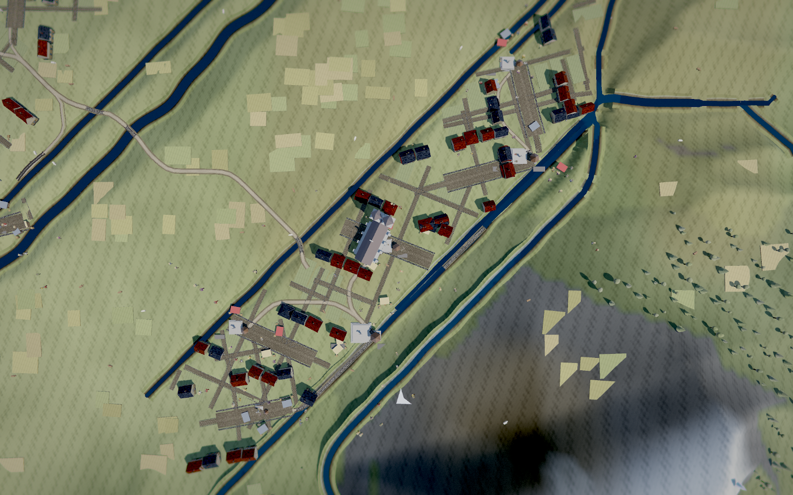
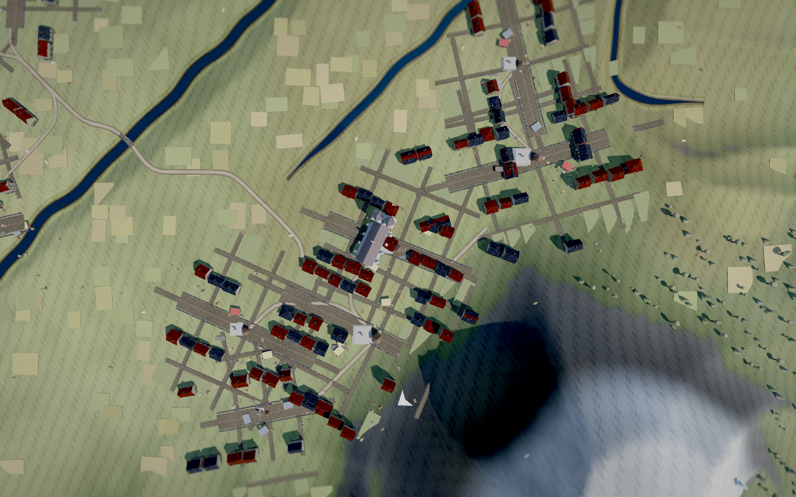
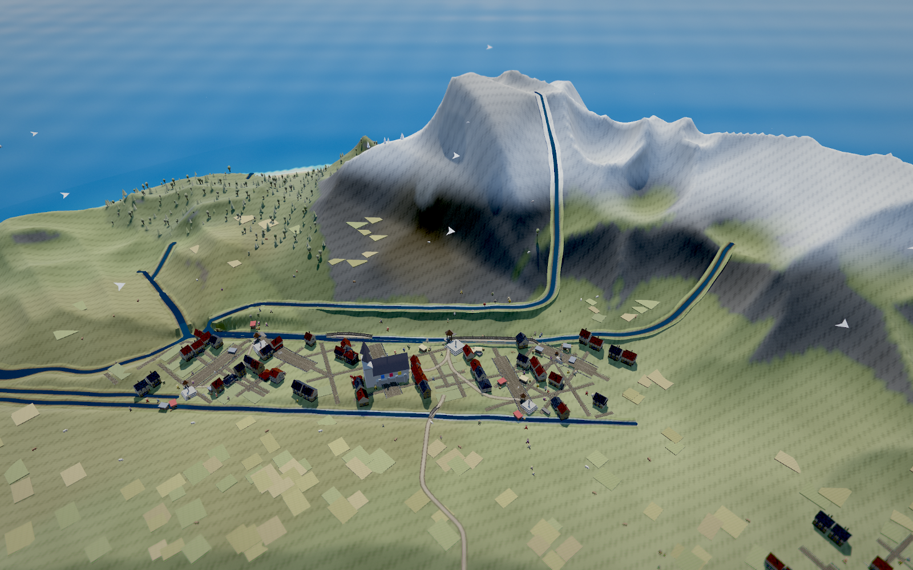
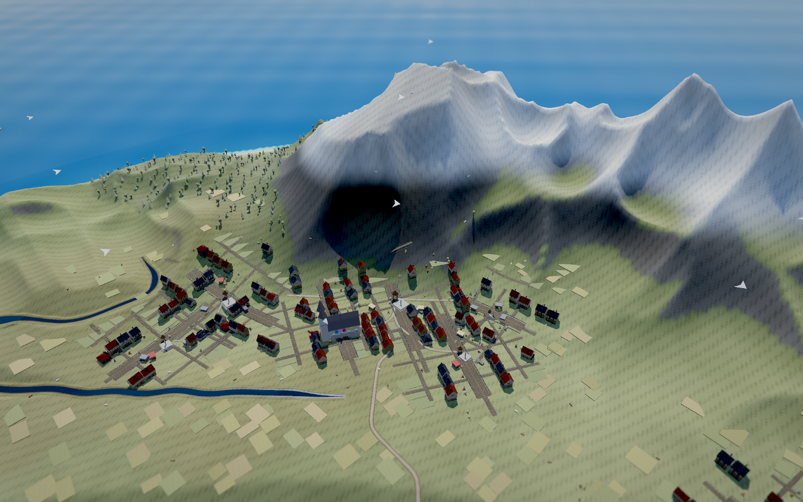

# PR 15 — source-backed river selection

Baseline: `303c93117b970b9a0a136b2ab82cea3d8e51e40d`.
The user's second screenshot shows long parallel side channels around the town
and abrupt hooked channel starts. This pass fixes selection/routing and the
submitted spring footprint, rather than treating those shapes as acceptable
because confluence topology passes.

## Confirmed causes and changes

- Every priority-flood spill cell previously became a rendered channel, even
  below the existing 1200-cell contributing-area threshold. Spills now route
  contributing area; only threshold-qualified paths are eligible for drawing.
- Source thinning previously dropped only source-start reaches, retaining
  downstream junction fragments. Selection now reconstructs the complete
  union of paths from retained headwaters to their outlets, then recomputes
  indegrees/reach starts. The existing 180 m source spacing and catchment
  threshold are unchanged. Equal-area source selection has an explicit cell-ID
  tie break.
- Settlement of the receiver graph used original terrain height although
  receivers descend on the deepened routing surface. It now uses routing
  height with a stable cell-ID tie break; priority-flood seeds use that same
  surface. Topological accumulation asserts every land cell was processed,
  and reach ordering asserts the graph is acyclic rather than appending an
  unresolved cyclic remainder.
- The renderer's established-channel width floor undid the spring taper.
  A retained source now starts at 0.30 m full width and smoothly reaches its
  full channel width over the existing 55 m ramp. The multiplier is applied
  after the width floor, so water, carving and banks consume the same taper.
  Shared degree-two rows normalize that multiplier when stamping a seam.
- A layout exposed a reversed ribbon triangle at XZ approximately
  (0.04903, −0.25159) world units. The bend-radius calculation was twice the
  true circumradius. Width and bank-inside constraints now use the true radius;
  full ribbon width is capped at 1.80 times that radius (90% per side), subject
  to the existing minimum established-channel width. The final-mesh winding
  gate remains enabled; triangles are not deleted or flipped to evade it.
- The old uphill diagnostic stored world units but printed metres. It now
  explicitly reports original-ground rise in metres and preserves the old
  effective 10 m per-sample ground bound (formerly 0.01 world units). This is
  not a measure of drawn-water uphill motion: the existing separate water-rise
  gate and final submitted mesh gates remain required. Routing constants now
  declare the 4 m outlet band, 2 m flood seed, 12/3 cm incisions and 1 mm flood
  step in physical units.
- Channel-run validation now unions intervals from actual upward submitted
  water triangles on both scan axes, including subcell-width streams. It uses
  the existing 250 m window and 14-run gross-artifact guard. The old cell-row
  count is labeled as a routing statistic and no longer claims to measure
  drawn channels. Duplicate faces merge, and trimmed profile rows cannot
  create runs. This guard is not proof of landscape plausibility.

## Trace and matched captures

The saved world is seed `6393821808673518700`, year 4583, hour 10, weather 0.
`before-network.json` records the exact prior-head reach graph; `after-network.json`
records the corrected graph. Sample arrays are [x, z, original-ground Y,
nominal width, channel width, water Y], all in world units (1 unit = 1 km).
The current CLI also exports dimensionless source-width multipliers separately.

Before: 77 reaches, 22 graph sources, 16 junctions. Three source starts had no
retained source declaration; 20 starts had only the 3 m fallback nominal width,
which the old implementation assigned when no threshold-qualified flow was
recorded at that cell. After: 11 reaches, six threshold-backed sources, five
junctions; zero unsupported starts and no inland terminal in this seed.
The minimum retained source catchment is 1202 grid cells.

These are changes to which channels genuinely exist in the generated graph,
not a render-only hide flag. Placements/carving/banks all receive the selected
network through the existing canonical field. Terrain/placement geometry and
water hashes therefore intentionally change; the simulation's historical replay
is unchanged by this render-network-only pass. Do not interpret reduced channel
counts as proof on their own: inspect the paired captures and final mesh gates.

| Before | After |
|---|---|
|  |  |
|  |  |

Explicit cameras:

```sh
# Overhead, town and side-channel corridor
EVOLVING_CAMERA='0.175,0.43,0.155,0.175,0.04,0.154,50'
# Oblique, mountain and town
EVOLVING_CAMERA='-0.15,0.40,-0.05,0.18,0.06,0.25,52'
```

`after-water-only.png` isolates the actual submitted water; additional terrain-only
and seed-1/seed-4 island captures are preserved locally in this folder. Before
captures use the unchanged prior-head CLI. Final production geometry matches the
captured source; subsequent diagnostic/fixture-only changes do not alter it.

## Scope and visual assessment

The parallel spill-only channels surrounding this town are removed, retained
source tips actually taper, and the corrected bend footprint passes unchanged
winding/clearance/exclusion gates. Main rivers and genuine tributaries remain.
These corrections do not promise fully natural drainage morphology for all seeds:
the retained D8 paths can still contain straight sections, source locations
remain a catchment-threshold model, and bridge/farmland assets are separate work.
The existing duplicate cap windings and steep bank-apron interpolation remain
P2 observations; this pass does not perform unrelated cleanup.

Review the current head only. A passing graph identity or run count is not a
visual acceptance criterion. Fresh clean automated review and CI are required
before merge; the agent does not merge the PR.

## Final validation and installed software

```text
./Scripts/build.sh: completed, all saver/apps/CLI built
./Scripts/verify.sh: verified build/Evolving.saver; 49 frames in 1.5 s
build/bin/civheadless determinism 2336 1: deterministic: OK
  geometry b0a3a1349f40473d; water 9d73defa8c9cdb86; terrain 0b68840f0c19703c
civheadless river 1..11 2336: 11/11 PASS
saved-world seed 6393821808673518700 at years 2336 and 4583: PASS
civheadless riverfixtures: 154 cases PASS, zero mismatches
civheadless riverterrainfixtures: 416 continuity pairs + four estuary orientations PASS
civheadless riverroutingfixtures: area/cycle/thinning/tie/spring/mesh-run cases PASS
./Scripts/install.sh: saver, Companion, Player and Timeline installed
installed native bundle: EvolvingSaver loaded; 48 frames in 1.5 s; OK
installed saver/Player/Timeline: signature and build-content comparisons PASS
```

Two independent determinism processes produced byte-identical output, and the
final rebuilt `build/bin/civheadless` process matched it again. Saved-world
geometry/water/terrain determinism passed separately at year 4583. All twelve
worlds report zero unsupported source starts, winding/area errors, topology or
footprint failures, terrain-clearance failures, above-water bank intrusions and
cut-seam failures. Across these worlds there are **384,984** whole-water terrain
probes; the reported minimum junction terrain clearance is 0.450 m. Worst
exhaustive terrain-reference error is **0.000024 m** (gate 1 mm), and worst
cut-seam height error is **0.000071 m**. Actual submitted channel-run maxima are
3–5 per 250 m across both scan axes. These are sampled finite-seed checks,
not proof for arbitrary worlds or natural-looking drainage.

[Per-seed results](seed-table.md) and [all intentional diagnostic changes](diagnostic-changes.txt)
compare against the prior PR head. Routing, source counts, source widths,
true curvature radius, raw-ground units, carved terrain, object placement and
water/terrain/placement geometry hashes intentionally change. Simulation
history for the same seed/year does not change in this particular follow-up.

I inspected both paired town views, seed-1 and seed-4 whole islands, the water-only
and terrain-only passes, plus the required `build/river-review.png` and
`build/river-paint-only.png`. The unwanted parallel town channels and hooked
spill starts are absent from the drawn footprint, rather than covered by land
or a shader. Genuine threshold-backed tributaries remain, with actual narrow
spring tips. I found no unresolved P0/P1 failure for this side-channel fix in
those views and the tested geometry. Recommendation: ready for fresh automated
review; merge only after required checks and a clean review of the new head.
This does not declare all landscape/endpoint design work complete.

Three alternating 24-frame runs at 6016×3384, scene scale 0.52, seed 1/year 2336,
weather 0: baseline [24.9, 18.96, 16.71]; patched [15.66, 19.28, 18.14] ms/frame. Median
18.96 → 18.14 ms/frame
(-4.3%). Run variation and
changed scene content prevent a hard budget guarantee. Process timing is also
retained in the raw logs, separate from frame timing. Final required still scene
construction/update was 4.67 s.

Quit any running Timeline/Player completely with Cmd-Q before reopening, so it
loads the newly installed saver rather than its cached old code:

```sh
open "$HOME/Applications/Evolving Timeline.app"
open "$HOME/Applications/Evolving Player.app"
```

In System Settings → Screen Saver choose Evolving. Player is fullscreen; Escape
exits. Timeline provides orbit/zoom and the year slider.

## Fixed findings

| Priority/location | Unit and observed → expected | Concrete check |
|---|---|---|
| P1 `Sources/CivRender/RiverNetwork.swift:964` | Contributing cells: below-threshold spill paths were drawn → only paths backed by >1200-cell headwaters | Saved-world before/after trace; all-source provenance and catchment gates; matched native town views |
| P1 `Sources/CivRender/RiverRouting.swift:31` | Graph sources: three unbacked starts after thinning → zero; complete selected paths retained | Synthetic orphan-arm fixture plus saved-world graph trace |
| P1 `Sources/CivRender/RiverNetwork.swift:929` | Height ordering, world units: original height did not order deepened receivers → routing-surface order with deterministic ties | Inspect receiver construction/order; full land-cell/topological and reach-cycle assertions in every tested build |
| P1 `Sources/CivRender/RiverRouting.swift:6` | Processed land cells: cycles could silently lose area → every land cell accounted for or explicit failure | Area-conservation fixture and deliberately cyclic two-cell fixture |
| P0 `Sources/CivRender/RiverNetwork.swift:1529` | Bend radius, m: old estimate was 2× true radius and exposed a reversed 0.03726 m² ribbon triangle → true radius and no invalid submitted faces | `bend-winding-regression.txt`; unchanged full-water winding gate across twelve seeds |
| P1 `Sources/CivRender/RiverNetwork.swift:214` | Submitted spring width: 2.8 m clamp undid taper → 0.30 m tip, full width by 55 m | Fixture checks actual emitted cap/ribbon vertices at all six saved-world sources; native water-only capture |
| P1 `Sources/CivRender/RiverMeshCrossings.swift:9` | Channel runs: pre-trim cell rows were not submitted mesh → union of actual upward water triangle intervals | Two 0.30 m ribbons plus a duplicate face count as two; final both-axis mesh statistics |
| P0 `Sources/CivRender/RiverNetwork.swift:77` | Ground-rise units: 0.01 world-unit guard was labeled 0.01 m → explicit unchanged 10 m ground guard and correct metre-valued reporting | Before/after diagnostic logs; separate downstream-water-rise and rendered-terrain checks remain enabled |
