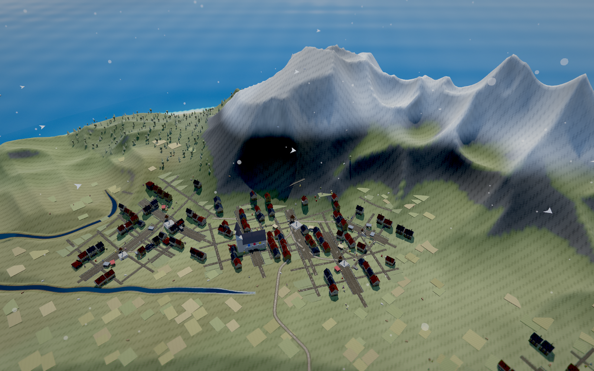
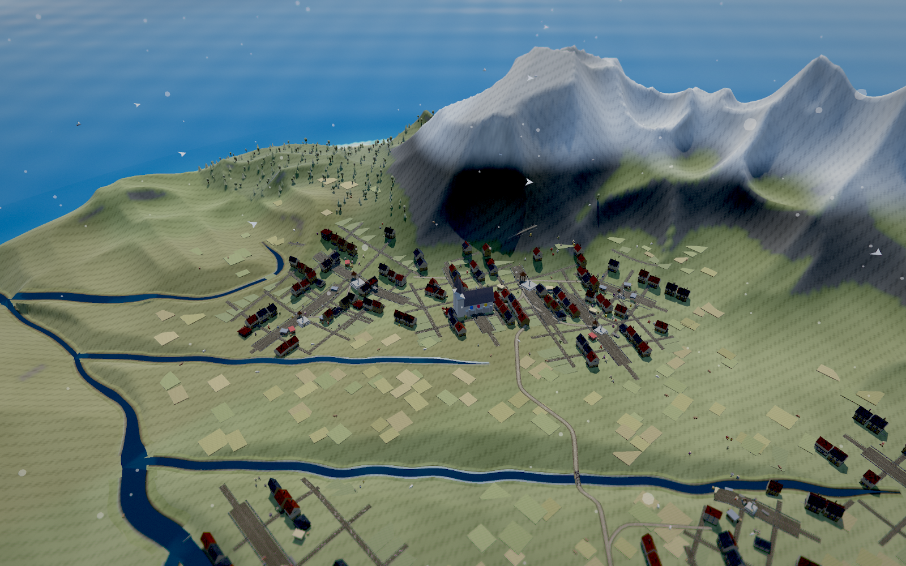
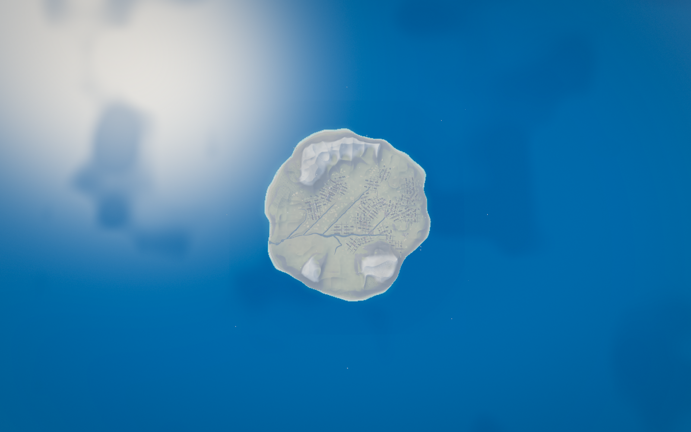

# Timeline navigation

- Shift-drag, right/middle-drag or two-finger scroll moves across the world.
- The visible **Move** button (M) makes normal left-drag move instead of orbit.
- WASD moves the camera; Shift increases the movement step.
- Pinch, Option-scroll or a conventional mouse wheel zooms. Manual zoom range
  is now 8 m–4 km instead of topping out at 450 m.
- Ordinary left-drag still orbits. Left/right arrow year stepping, playback,
  Auto and double-click-to-auto retain their existing roles.
- Manual control takes over the displayed eye, target and field of view, even
  for a street/near-horizontal or overhead shot; it no longer jumps to a town.
- Ground-plane panning follows screen right/up at every bearing and normalizes
  pointer distance by viewport height. The control bar has a visible Move toggle
  and the updated tooltip describes trackpad and keyboard controls.

The user screenshot still shows stylized angular streams, flat farmland/bridge
assets and conspicuous white bird models. Those are not declared finished visual
polish here. White triangles are consistent with the existing two-triangle bird
mesh (10.8 m wingspan at its current 9 m model scale); an individual still is not
proof of a new terrain/confluence defect. This change does not alter river
selection, water/bank meshes, terrain carving or bird/prop geometry.

## Validation

```text
./Scripts/build.sh: completed, all products built
./Scripts/verify.sh: verified build/Evolving.saver; 48 frames in 1.5 s
EvolvingTimeline --check-navigation: PASS native AppKit input routing
civheadless cameracheck review/timeline-navigation: PASS actual renderer movement
civheadless determinism 2336 1: deterministic: OK; hashes unchanged from f3a6a5d
./Scripts/install.sh: saver, Companion, Player and Timeline installed
installed Timeline --check-navigation: PASS
installed saver: EvolvingSaver loaded; 49 frames in 1.5 s; OK
installed saver and Timeline: valid signatures; contents match final build
```

The native input test injects actual NSEvent pointer, wheel and key events. It
checks orbit vs Shift-drag/Move/right-drag, trackpad scroll vs Option-scroll and
mouse wheel, and keyboard forward movement. The Metal renderer test checks the
initial shot and FOV, projected right/up movement at four bearings and five
pitches (including street and overhead), both zoom bounds and Auto release.
These are native-event/renderer checks, not a physical-trackpad usability trial.

Geometry/placement/water/terrain hashes match the prior river-fix head exactly:
`b0a3a1349f40473d`, `9d73defa8c9cdb86`, `0b68840f0c19703c`.
The earlier twelve-world river suite remains recorded in `review/side-rivers/`;
it was not repeated for this camera-only change. The standard build verification
rendered years 500, 5000 and 10000. No GitHub Actions changes.

I inspected the native screenshots below. The after view translates the scene
without substituting a different town or changing orbit orientation/FOV.

| Before pan | After pan |
|---|---|
|  |  |



Quit the running Timeline with Cmd-Q, then reopen the installed version:

```sh
open "$HOME/Applications/Evolving Timeline.app"
```
